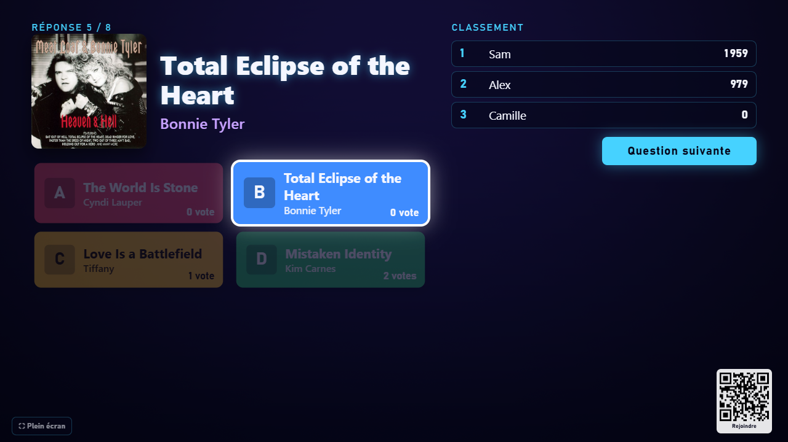
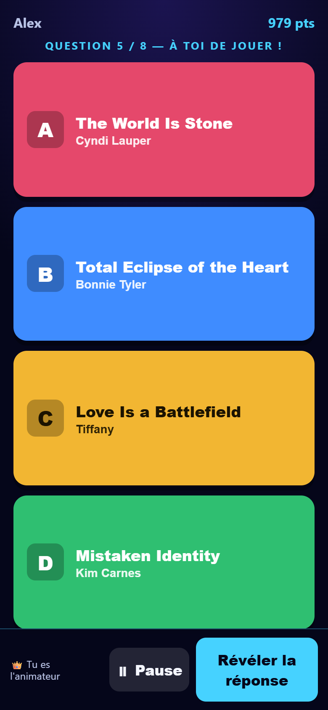
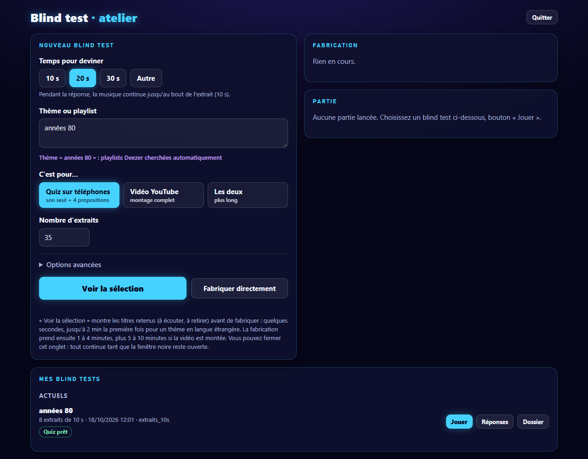
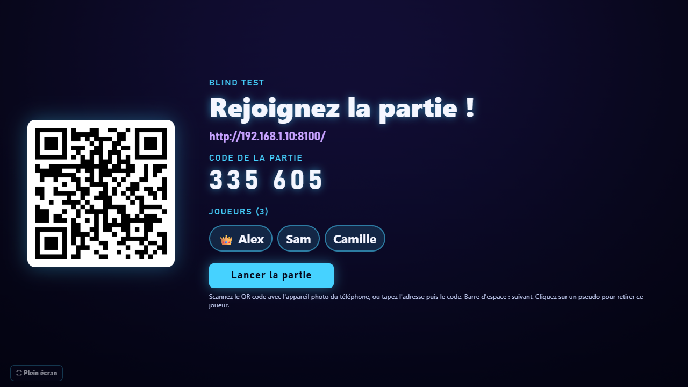
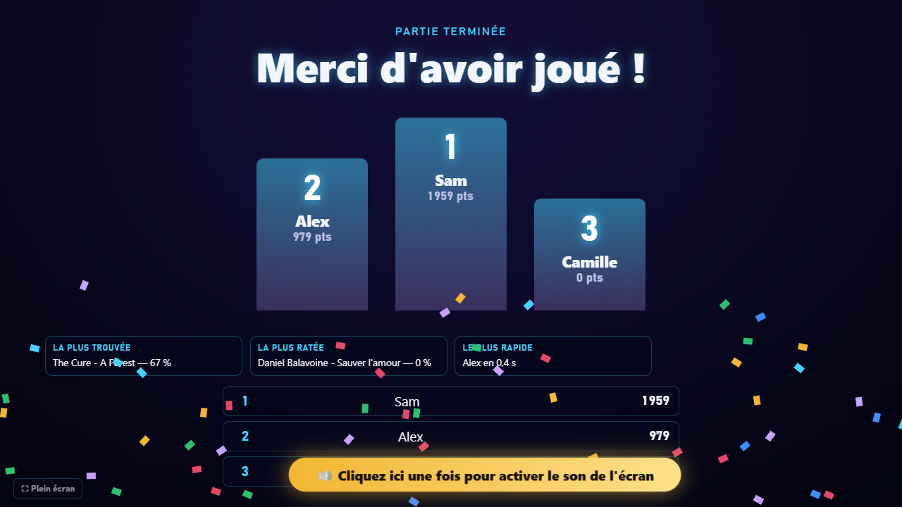

# 🎵 Blind test entre amis

Un blind test façon **Kahoot**, pour jouer en soirée : la musique passe sur la télé ou l'ordinateur,
chacun répond sur **son téléphone**, et un classement s'affiche après chaque chanson.

Vous choisissez un thème (« années 80 », « comédies musicales »…), une playlist Deezer ou Spotify, ou votre
propre liste de chansons : le programme prépare tout seul les extraits et les questions.

| L'écran principal (télé, PC) | Le téléphone de chaque joueur |
|---|---|
|  |  |

**Aucune application à installer sur les téléphones** : on scanne un QR code et on joue dans le navigateur.

---

## Sommaire

1. [Installer](#1-installer-5-minutes-une-seule-fois)
2. [Fabriquer un blind test](#2-fabriquer-un-blind-test)
3. [Jouer](#3-jouer)
4. [Les modes de jeu](#4-les-modes-de-jeu)
5. [Corriger les réponses](#5-corriger-les-réponses)
6. [Jouer à distance (4G, autre maison)](#6-jouer-à-distance)
7. [En cas de problème](#7-en-cas-de-problème)
8. [Bon à savoir](#8-bon-à-savoir)

---

## 1. Installer (5 minutes, une seule fois)

Il faut un **PC sous Windows 10 ou 11** ou un **Mac**, relié à Internet.

### Sur Windows

1. **Téléchargez** le programme : en haut de cette page, bouton vert **« Code »** puis **« Download ZIP »**
   (ou la dernière version dans **« Releases »**, à droite).
2. **Décompressez** le fichier ZIP (clic droit → « Extraire tout… »), par exemple dans « Documents ».
3. Dans le dossier obtenu, **double-cliquez sur `Installer.bat`**.
   Il installe ce qui manque (Python et ffmpeg, deux programmes gratuits) et crée un raccourci
   **« Blind test »** sur le bureau.

> Windows peut afficher « Windows a protégé votre ordinateur » : cliquez sur **« Informations complémentaires »**
> puis **« Exécuter quand même »**. C'est normal pour un programme téléchargé qui n'est pas vendu en magasin.

### Sur Mac

1. **Téléchargez** le programme (bouton vert **« Code »** puis **« Download ZIP »**, ou **« Releases »**) ;
   le Mac le décompresse tout seul (sinon, double-cliquez sur le ZIP).
2. Dans le dossier obtenu, faites un **clic droit sur `Installer (Mac).command` → « Ouvrir »**, puis confirmez
   **« Ouvrir »**. Si le Mac refuse : **Réglages Système → Confidentialité et sécurité**, tout en bas,
   **« Ouvrir quand même »**. C'est normal pour un programme qui ne vient pas de l'App Store.
3. Il installe ce qui manque (Homebrew, Python et ffmpeg : le mot de passe du Mac est demandé, rien ne
   s'affiche pendant la frappe) et crée un raccourci **« Blind test »** sur le bureau. Comptez 5 à 15 minutes.

> Si le Mac demande d'**accepter les connexions entrantes** pour Python : cliquez sur **« Autoriser »**.

### Ensuite

Il suffit de **double-cliquer sur « Blind test »** sur le bureau. Une fenêtre s'ouvre
(laissez-la ouverte, vous pouvez la réduire) et la page de l'**atelier** s'affiche dans votre navigateur.

> **Au premier lancement sur Windows**, Windows demande l'autorisation du pare-feu : cochez **« Réseaux privés »**
> (et « Réseaux publics » si votre box est en réseau public) puis **« Autoriser »**. Sans cela, les téléphones
> ne pourront pas se connecter.

---

## 2. Fabriquer un blind test

Dans l'atelier :

1. **Temps pour deviner** : 10, 20 ou 30 secondes (ou une autre durée de 5 à 30 s).
2. **Thème ou playlist**, au choix :
   - un **thème** : « années 80 », « rap français », « comédies musicales »… Les playlists Deezer
     correspondantes sont trouvées automatiquement. Un thème avec une langue (« chanson française »,
     « pop anglaise ») ne prend **que** des chansons dans cette langue ;
   - un **lien de playlist Deezer ou Spotify** (copier-coller depuis l'application) ;
   - une **liste de chansons**, une par ligne : `Artiste - Titre` (voir le dossier [`exemples`](exemples)).
3. **C'est pour…** : le **quiz sur téléphones**, une **vidéo YouTube** toute prête (avec décompte et réponses),
   ou les deux.
4. **Voir la sélection** : vous écoutez les titres retenus, vous retirez ceux qui ne vous plaisent pas,
   puis **« Fabriquer avec cette sélection »**. Comptez 1 à 4 minutes (5 à 10 de plus pour une vidéo).

Vos blind tests apparaissent dans **« Mes blind tests »**. Un nouveau blind test de la même durée remplace
l'actuel, qui est rangé dans les **archives** (toujours jouable). Le **mode essai** (options avancées) fabrique
à part, sans rien remplacer ; un bon essai se garde avec **« Garder cet essai »**.

---

## 3. Jouer

1. Dans « Mes blind tests », cliquez sur **« Jouer »**, choisissez le **mode de jeu** et éventuellement des
   **équipes**, puis **« Lancer la partie »**.
2. Cliquez sur **« Ouvrir l'écran de jeu »** : mettez cette page sur la télé (ou en plein écran avec la touche **F**).
3. Les joueurs **scannent le QR code** avec l'appareil photo de leur téléphone et choisissent un pseudo.
4. Lancez la partie : bouton **« Lancer la partie »** sur l'écran… ou depuis le téléphone de l'**animateur**.

| Salle d'attente | Fin de partie |
|---|---|
|  |  |

- **👑 L'animateur** : le premier joueur inscrit peut piloter la partie depuis son téléphone
  (lancer, pause, révéler, question suivante, rejouer). Pratique quand l'ordinateur est loin.
- **Points** : de 1 000 (réponse immédiate) à 500 (dernière seconde). **Séries** 🔥 : +100 points par bonne
  réponse de suite. Certaines questions valent **×2**.
- **Sur l'écran** : pause (**P**), réécouter l'extrait (**R**), révéler (**barre d'espace**), plein écran (**F**).
  Cliquez sur un pseudo dans la salle d'attente pour retirer un joueur.
- **Le son** : la première fois, cliquez n'importe où sur l'écran de jeu si un bandeau jaune vous le demande
  (les navigateurs bloquent le son tant qu'on n'a pas cliqué sur la page).
- **Si l'ordinateur s'éteint en pleine partie**, l'atelier propose de la **reprendre** au prochain lancement,
  avec les mêmes scores.

---

## 4. Les modes de jeu

| Mode | Principe |
|---|---|
| **Classique** | 4 propositions (titre, artiste ou film / spectacle selon le blind test) |
| **Lettre par lettre** | les 4 propositions s'écrivent lettre par lettre pendant l'extrait : répondre tôt rapporte plus, avec moins d'indices |
| **Trouver l'année** | chacun propose une année de sortie avec un curseur ; plus on est proche, plus on marque |
| **Quelle langue ?** | dans quelle langue la chanson est-elle chantée ? (idéal avec [`exemples/Langues du monde`](exemples)) |
| **Quel pays ?** | de quel pays vient l'artiste ? |

Le mode **équipes** (2 à 4) fonctionne avec tous les modes : chacun choisit son équipe sur son téléphone,
le score d'une équipe est la moyenne de ses joueurs.

---

## 5. Corriger les réponses

Le programme se trompe parfois (un film mal reconnu, une version live…). Dans « Mes blind tests », le bouton
**« Réponses »** ouvre l'éditeur : vous **écoutez** chaque extrait, vous **corrigez** le texte, ou vous
**remplacez** le morceau (recherche Deezer intégrée). Le quiz se met à jour tout seul.
Le bouton **« À vérifier »** liste les questions que le programme juge douteuses.

---

## 6. Jouer à distance

Par défaut, les téléphones doivent être sur **le même Wi-Fi** que l'ordinateur. Pour jouer en 4G ou depuis
une autre maison, choisissez **« Internet »** dans la fenêtre « Jouer ». Il faut pour cela l'un de ces deux
programmes gratuits (à installer une fois) :

- **Cloudflare** (le plus simple) : ouvrez « Invite de commandes » et tapez
  `winget install Cloudflare.cloudflared`
  (sur Mac, dans le Terminal : `brew install cloudflared`). L'adresse change à chaque partie.
- **Tailscale** (adresse fixe d'une soirée à l'autre) : installez Tailscale, créez un compte gratuit et
  activez « Funnel ». Le blind test l'utilise automatiquement s'il est connecté.

---

## 7. En cas de problème

| Problème | Solution |
|---|---|
| Les téléphones ne trouvent pas la partie | Ils doivent être sur le **même Wi-Fi** que le PC (pas le Wi-Fi « invité » de la box, qui isole les appareils). Vérifiez l'autorisation du pare-feu (voir l'installation), ou choisissez le mode **Internet**. |
| Pas de son sur l'écran | Cliquez une fois n'importe où sur la page de l'écran de jeu. Vérifiez le volume du PC / de la télé. |
| « Python est introuvable » | Relancez `Installer.bat` (ou `Installer (Mac).command`), ou redémarrez l'ordinateur après l'installation. |
| Mac : « impossible d'ouvrir … développeur non identifié » | Clic droit sur le fichier → « Ouvrir », ou Réglages Système → Confidentialité et sécurité → « Ouvrir quand même ». |
| « Introuvable : ffmpeg » | Relancez `Installer.bat` (Mac : `Installer (Mac).command`), ou copiez `ffmpeg.exe` et `ffprobe.exe` dans le dossier du blind test. |
| Une chanson manque ou une réponse est fausse | Éditeur de réponses (bouton « Réponses »). |
| Le programme s'est arrêté | Ouvrez `journal.txt` dans le dossier : la dernière ligne indique ce qui s'est passé. Joignez-le si vous signalez un problème. |

Pour signaler un problème ou proposer une idée : onglet **« Issues »** de cette page.

---

## 8. Bon à savoir

- **Windows 10 / 11 ou Mac** pour l'ordinateur qui anime (les téléphones peuvent être des iPhone ou des Android,
  même anciens). La version Mac est récente : n'hésitez pas à signaler tout souci (onglet « Issues »).
- **Usage privé** : le programme utilise les extraits de 30 secondes que Deezer met librement à disposition,
  pour jouer entre amis. Les playlists Spotify sont lues par une méthode non officielle qui peut cesser de
  fonctionner. Si vous publiez une vidéo sur YouTube, les droits des chansons restent à votre charge
  (YouTube peut la démonétiser ou la bloquer).
- **Données** : années de sortie, pays des artistes et profils viennent de [MusicBrainz](https://musicbrainz.org),
  base musicale libre ; la première préparation d'un blind test peut donc prendre une ou deux minutes.
- **Rien n'est envoyé ailleurs** que vers Deezer, Spotify (lecture des playlists) et MusicBrainz. Tout reste sur
  votre PC.

### Pour les curieux

| Fichier | Rôle |
|---|---|
| `jeu.py` | le programme principal : atelier, serveur de jeu, modes, équipes |
| `blindtest.py` | la fabrication : recherche des chansons, découpe des extraits, vidéo |
| `donnees_quiz.py` | les langues, pays et œuvres utilisés comme fausses propositions |
| `jeu/*.html` | les pages : atelier, écran de jeu, téléphone |
| `*.bat` / `*.command` | installation et lancement sur Windows / sur Mac |

En ligne de commande : `python blindtest.py --help` et `python jeu.py --help`. Aucune bibliothèque Python à
installer (Python 3.9 ou plus récent, et ffmpeg).

## Licence

[MIT](LICENSE) : libre d'utiliser, de modifier et de partager, sans garantie.
